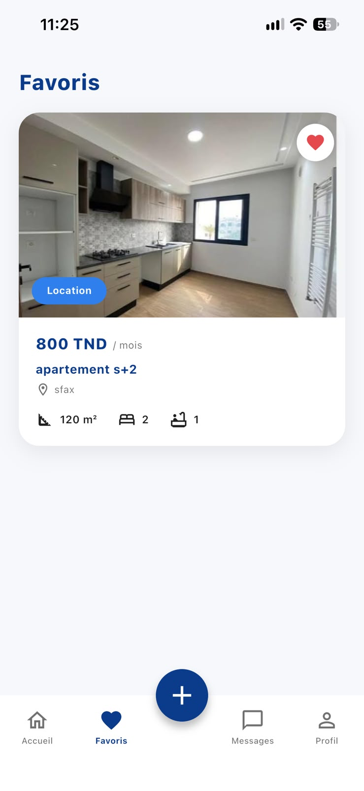
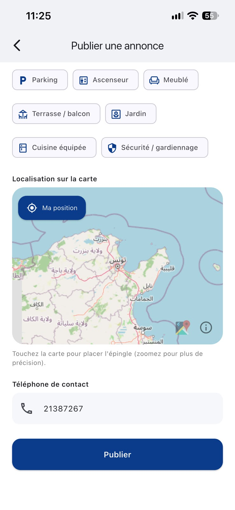
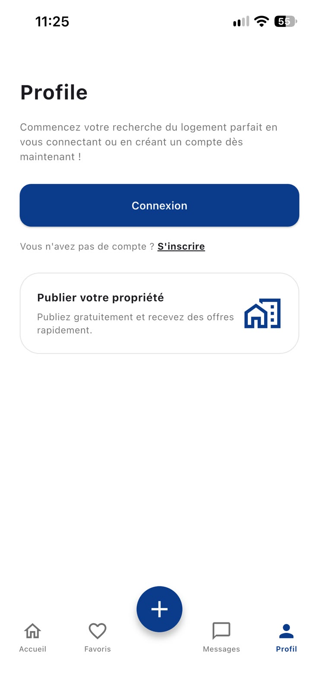
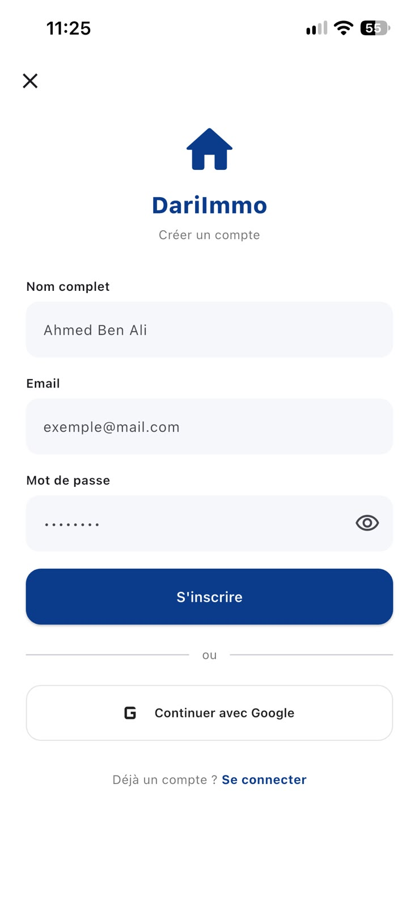

# 🏡 DariImmo

**DariImmo** est une application mobile de gestion et de consultation d'annonces immobilières en Tunisie. Elle permet aux utilisateurs de découvrir des biens immobiliers, publier leurs propres annonces, gérer leurs favoris et communiquer avec d'autres utilisateurs.

L'application est développée avec **Flutter** et utilise **Firebase** pour l'authentification et la gestion des données.

---

## 📱 Aperçu de l'application

### Captures d'écran

<h2>📱 Captures d'écran</h2>

<table>
  <tr>
    <td align="center">
      
      <br>Accueil
    </td>
    <td align="center">
      
      <br>Favoris
    </td>
    <td align="center">
      
      <br>Publication 1
    </td>
  </tr>
  <tr>
    <td align="center">
      
      <br>Publication 2
    </td>
    <td align="center">
      
      <br>Messages
    </td>
    <td align="center">
      
      <br>Profil
    </td>
  </tr>
  <tr>
    <td align="center">
      
      <br>Mes annonces
    </td>
    <td align="center">
      
      <br>Paramètres
    </td>
    <td align="center">
      
      <br>Profil invité
    </td>
  </tr>
  <tr>
    <td align="center">
      
      <br>Connexion
    </td>
    <td align="center">
      
      <br>Inscription
    </td>
  </tr>
</table>

## ✨ Fonctionnalités principales

### 🏠 Consultation des annonces
- Consulter les annonces immobilières disponibles.
- Découvrir les biens immobiliers proposés.
- Consulter les détails des annonces.

### ❤️ Gestion des favoris
- Ajouter des annonces aux favoris.
- Consulter la liste des annonces favorites.

### 📝 Publication des annonces
- Publier une nouvelle annonce immobilière.
- Remplir les informations du bien immobilier.
- Ajouter des photos.
- Organiser la publication en plusieurs étapes.

### 💬 Messagerie
- Accéder à la messagerie.
- Consulter les conversations.
- Communiquer avec les autres utilisateurs.

### 👤 Gestion du profil
- Créer un compte.
- Se connecter à l'application.
- Consulter son profil.
- Modifier les informations personnelles.
- Consulter et gérer ses propres annonces.

### ⚙️ Paramètres
- Accéder aux paramètres de l'application.
- Gérer les préférences du compte.

### 👀 Mode invité
- Découvrir l'application sans créer immédiatement un compte.

---

## 🛠️ Technologies utilisées

| Technologie | Utilisation |
|---|---|
| Flutter | Développement de l'application mobile |
| Dart | Langage de programmation |
| Firebase Authentication | Authentification des utilisateurs |
| Cloud Firestore | Gestion et stockage des données |
| Google Sign-In | Connexion avec un compte Google |
| Riverpod | Gestion de l'état de l'application |
| GoRouter | Navigation entre les écrans |
| Flutter Map / OpenStreetMap | Affichage des cartes |
| Geolocator | Localisation géographique |
| Image Picker | Sélection des images |
| Cached Network Image | Chargement et mise en cache des images |
| Cloudinary | Gestion des images |

---

## 🏗️ Architecture du projet

Le projet est organisé selon une architecture basée sur les fonctionnalités (*Feature-based architecture*).

```text
flutter_app/
│
├── android/
├── ios/
├── assets/
│
├── docs/
│   └── screenshots/
│       ├── 01-accueil.png
│       ├── 02-favoris.png
│       ├── 03-publier-partie-1.png
│       ├── 04-publier-partie-2.png
│       ├── 05-messages.png
│       ├── 06-profil.png
│       ├── 07-mes-annonces.png
│       ├── 08-parametres.png
│       ├── 09-profile-invite.png
│       ├── 10-connexion.png
│       └── 11-inscription.png
│
├── lib/
│   ├── features/
│   │   ├── auth/
│   │   ├── home/
│   │   ├── favorites/
│   │   ├── profile/
│   │   ├── chat/
│   │   └── ...
│   │
│   ├── main.dart
│   └── firebase_options.dart
│
├── pubspec.yaml
└── README.md
```

---

## ⚙️ Installation et configuration

### 1. Prérequis

Avant de commencer, assurez-vous d'avoir installé :

- [Flutter SDK](https://docs.flutter.dev/get-started/install)
- [Dart SDK](https://dart.dev/get-dart)
- [Android Studio](https://developer.android.com/studio) ou [Xcode](https://developer.apple.com/xcode/) pour exécuter l'application.
- [Git](https://git-scm.com/)

### 2. Cloner le projet

```bash
git clone <URL_DU_DEPOT>
```

Accéder au dossier du projet :

```bash
cd <NOM_DU_DOSSIER>
```

### 3. Installer les dépendances

```bash
flutter pub get
```

### 4. Configuration Firebase

L'application utilise Firebase pour l'authentification et le stockage des données.

Pour configurer Firebase :

1. Créer un projet sur [Firebase Console](https://console.firebase.google.com/).
2. Ajouter les applications Android et iOS au projet Firebase.
3. Configurer Firebase Authentication.
4. Activer Cloud Firestore.
5. Générer le fichier `firebase_options.dart` avec FlutterFire CLI si nécessaire.
6. Ajouter les fichiers de configuration Firebase correspondant aux plateformes.

Pour iOS, le fichier `GoogleService-Info.plist` doit être placé dans :

```text
ios/Runner/GoogleService-Info.plist
```

Pour Android, le fichier `google-services.json` doit être placé dans :

```text
android/app/google-services.json
```

### 5. Lancer l'application

Vérifier les appareils disponibles :

```bash
flutter devices
```

Lancer l'application :

```bash
flutter run
```

Pour générer une version iOS Release :

```bash
flutter build ios --release
```

---

## 🔐 Sécurité

- L'authentification des utilisateurs est gérée par Firebase Authentication.
- Les accès aux données doivent être protégés par les règles de sécurité Firestore.
- Les clés privées et les identifiants sensibles ne doivent pas être publiés dans un dépôt GitHub public.

---

## 📂 Structure des fonctionnalités

| Module | Description |
|---|---|
| Authentication | Inscription et connexion |
| Home | Accueil et consultation des annonces |
| Favorites | Gestion des annonces favorites |
| Profile | Profil utilisateur et paramètres |
| Chat | Messagerie entre utilisateurs |
| Publication | Création et gestion des annonces |

---

## 👩‍💻 Informations sur le projet

**Nom du projet :** DariImmo  
**Type :** Application mobile immobilière  
**Domaine :** Immobilier  
**Framework :** Flutter  
**Langage :** Dart  
**Backend :** Firebase  

---

## 🚀 Objectif du projet

DariImmo a pour objectif de faciliter la recherche et la publication de biens immobiliers en Tunisie à travers une application mobile simple, moderne et intuitive.

