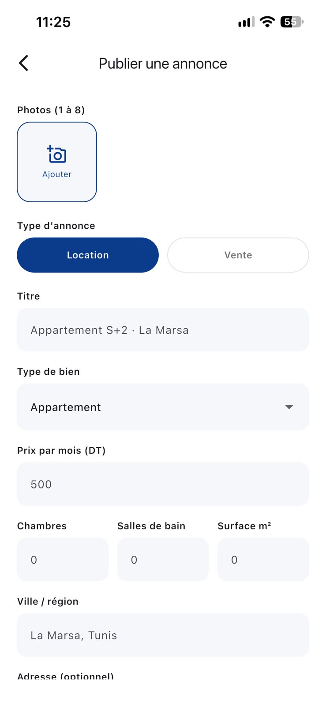
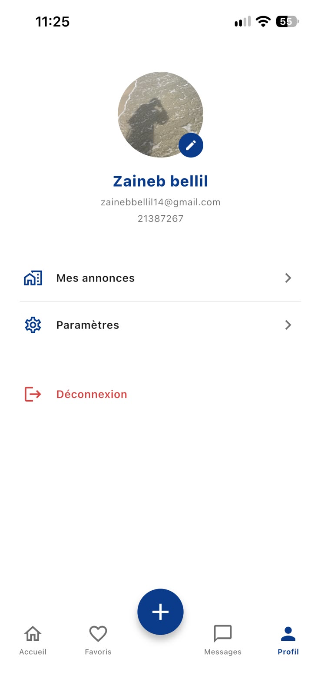
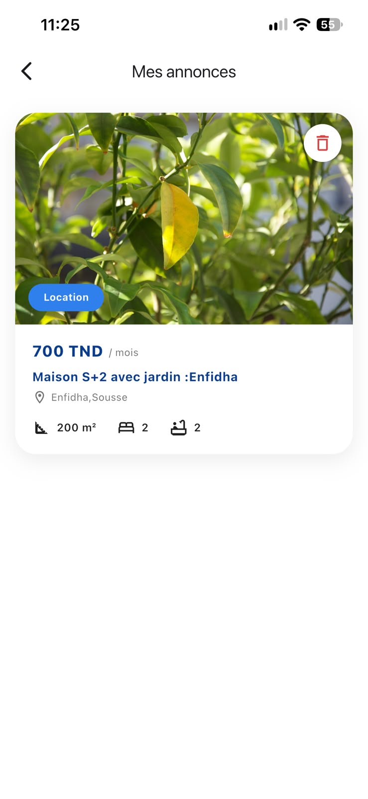
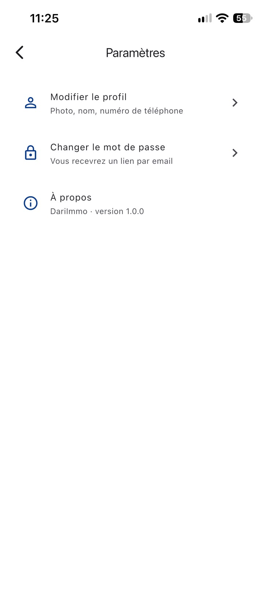

# DariImmo

<p align="center">
  <strong>Application mobile tunisienne de location et de vente immobilière.</strong>
</p>

DariImmo permet de publier, rechercher, enregistrer et gérer des annonces immobilières. Les utilisateurs peuvent contacter les propriétaires via la messagerie intégrée, consulter les annonces sur une carte et gérer leur profil.

## Fonctionnalités

- Recherche d'annonces par ville, quartier ou mot-clé
- Filtrage entre location et vente
- Consultation détaillée des biens avec photos, équipements et localisation
- Publication d'annonces avec photos et position sur la carte
- Gestion des annonces favorites
- Messagerie entre acheteurs, locataires et propriétaires
- Création de compte, connexion email/mot de passe et Google
- Gestion du profil, des paramètres et des annonces publiées
- Interface responsive adaptée aux écrans mobiles

## Captures d'écran

### Accueil

| Accueil | Favoris |
|---|---|
|  |  |

### Publication d'une annonce

| Informations principales | Équipements et localisation |
|---|---|
|  |  |

### Messagerie et compte

| Messages | Profil |
|---|---|
|  |  |

| Mes annonces | Paramètres |
|---|---|
|  |  |

### Authentification

| Profil invité | Connexion |
|---|---|
|  |  |

<p align="center">
  
</p>

## Technologies

- **Framework :** Flutter / Dart
- **Gestion d'état :** Flutter Riverpod
- **Navigation :** GoRouter
- **Backend :** Firebase Authentication et Cloud Firestore
- **Connexion Google :** Google Sign-In
- **Cartes :** Flutter Map, OpenStreetMap et Geolocator
- **Images :** Image Picker, Cached Network Image et Cloudinary

## Architecture

```text
lib/
├── core/
│   ├── constants/       # Constantes communes
│   ├── router/          # Configuration GoRouter
│   ├── theme/           # Thème et styles globaux
│   └── widgets/         # Widgets partagés
├── features/
│   ├── auth/            # Connexion, inscription et vérification
│   ├── chat/            # Messagerie et conversations
│   ├── favorites/       # Gestion des favoris
│   ├── listings/        # Recherche, détails et publication
│   ├── map/             # Carte et sélection de localisation
│   ├── profile/         # Profil, paramètres et annonces
│   └── search/          # Fonctionnalités de recherche
├── firebase_options.dart
└── main.dart
```

## Prérequis

- Flutter SDK 3.13 ou supérieur
- Dart SDK 3.13 ou supérieur
- Android Studio ou VS Code
- Un projet Firebase configuré
- Un émulateur ou un appareil Android/iOS

## Installation

1. Cloner le projet :

```bash
git clone <url-du-depot>
cd flutter_app
```

2. Installer les dépendances :

```bash
flutter pub get
```

3. Configurer Firebase pour les plateformes utilisées :

```bash
flutterfire configure
```

4. Vérifier l'installation :

```bash
flutter doctor
```

5. Lancer l'application :

```bash
flutter run
```

## Configuration requise

Le projet utilise les services Firebase suivants :

- Firebase Authentication
- Cloud Firestore
- Google Sign-In

Pour Android, ajoutez le fichier `google-services.json` dans `android/app/`.  
Pour iOS, ajoutez le fichier `GoogleService-Info.plist` dans `ios/Runner/`.

Ne publiez jamais les clés privées, fichiers de configuration sensibles ou identifiants Cloudinary dans un dépôt public.

## Analyse et tests

```bash
flutter analyze
flutter test
```

## Informations du projet

- **Nom :** DariImmo
- **Version :** 1.0.0
- **Plateformes :** Android, iOS, macOS, Web
